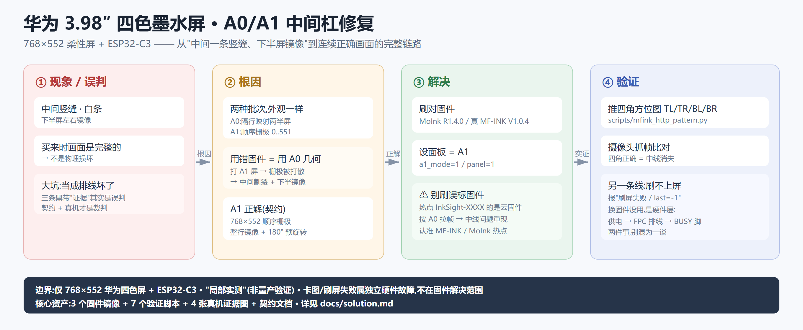

# 华为 3.98″ 墨水屏 · A0/A1 中间杠修复

## [打开完整解决方案(图文)↗](docs/solution.md)

[](docs/solution.md)

**先看这张图**:一条主链路讲清"中间一条杠"是怎么来的、怎么修、怎么验证。

---

## 关于本项目

华为 3.98″ 768×552 四色柔性墨水屏 + ESP32-C3,刷通用固件后中间出现竖缝/白条、下半屏镜像的人不少。**给谁**:遇到这类中间杠/镜像问题的人。**解决什么**:把"看着像屏坏了"的中间杠定位到 A0/A1 栅极映射差异,给出验证过的固件 + A1 契约打包法。**不处理**:排线/供电类"刷屏失败"(属独立硬件问题,见[边界](#边界))。README 只负责分流,完整方法论在 [docs/solution.md](docs/solution.md)。

[关于本项目](#关于本项目) · [接线对照](#接线对照esp32-c3-super-mini) · [核心方法论](docs/solution.md) · [怎么跑](#怎么跑) · [验证结果](#验证结果) · [常见问题](#常见问题) · [边界](#边界) · [仓库结构](#仓库结构)

## 从哪里开始阅读

| 你的目的 | 建议路线 |
|---|---|
| 只想修好中间那条杠 | [怎么跑](#怎么跑) → [常见问题](#常见问题) |
| 想知道根因(为什么不是屏坏了) | [根因与契约](docs/solution.md#二根因a0-与-a1-的栅极映射差异) → [A1 正解](docs/solution.md#三a1-唯一正解契约) |
| 刷上去没反应 / 刷屏失败 | [两条独立故障线](docs/solution.md#六两条独立故障线最容易混的地方) → [常见问题](#常见问题) |
| 想移植进自己的固件 | [原生移植落点](docs/solution.md#八若要原生移植进-inksight-固件未来) |
| 拿到板子不知道线怎么接 | [接线对照](#接线对照esp32-c3-super-mini) → [怎么跑](#怎么跑) |

## 接线对照(ESP32-C3 Super Mini)

**先接对线,再谈刷固件。** 这是华为这块 768×552 四色屏 + ESP32-C3 Super Mini 的实测接线,`"左侧/右侧"`指 Super Mini 板上 USB-C 口朝上时的引脚物理位置。

| 屏幕引脚 | 接 Super Mini 引脚 | 板上位置 |
|---|---|---|
| 3.3V | 3.3V(标 `3.3`) | 左侧 |
| GND | GND(标 `G`) | 左侧 |
| SDA / DIN | GPIO6 | 右侧 |
| CLK / SCK | GPIO4 | 左侧 |
| DC | GPIO1 | 左侧 |
| CS | GPIO7 | 右侧 |
| **RST** | **GPIO3** | 左侧 |
| BUSY | GPIO10 | 右侧 |

> **经验教训(最容易上来就弄错的一条):真 MF-INK 固件的 RST 接 GPIO3,不是 GPIO2。**
> 我们在这块板上把 RST 在 GPIO2 / GPIO3 之间来回改过,最后确认 MF 部件认 GPIO3——接错就直接"不刷新 / 没 WiFi",看着像屏坏或固件坏,其实是 RST 引脚对不上。
> MoInk R1.4.0 的预设不同(RST 在 GPIO3 可用),换固件时先按上表对一遍 RST,别凭印象。

相关:[RST 接线与固件预设不匹配的故障线](docs/solution.md#六两条独立故障线最容易混的地方) · [常见问题](#常见问题)

## 这是什么问题

刷了网上常见的 3.98 寸墨水屏固件后,屏幕买来时完整的中画面变成中间一道竖缝、下半屏左右颠倒。多数人被误导去查排线。

| 场景难点 | 我们的处理方式 |
|---|---|
| 中间竖缝 + 下半屏镜像,看着像物理损坏 | 定位到 A0/A1 批次栅极映射不同,不是屏坏 |
| 网上固件大多只支持 A0 | 给出 A1 唯一正解:顺序栅极 + 整行镜像 + 180° 预旋转 |
| 同样是"屏幕不对",卡图和中线混在一起 | 拆成两条独立故障线,分别处理 |

## 核心设计(怎么解决中间一条杠)

### 1. 认根因,不看照片下结论

中间杠 = A0 的隔行映射被套到 A1 屏上。A1 是**顺序栅极 0..551**,不是 A0 的 `j<H/2 ? 2j : 2(H-j)-1`。曾误判为物理中缝,真机顺序写栅极得到连续画面推翻了该结论。**我们没有做什么**:没有换屏、没有动排线来"修"映射问题。

相关:[根因详解](docs/solution.md#二根因a0-与-a1-的栅极映射差异)

### 2. 按契约打包帧,不是照搬 A0

A1 帧必须是 768×552、顺序栅极、整行镜像,打包含 180° 预旋转;800×600 只是诊断档。**我们没有做什么**:没用网上的 A0 帧几何,也没开局部刷新。

相关:[A1 契约](docs/solution.md#三a1-唯一正解契约) · [打包实现](scripts/mfink_http_pattern.py)

### 3. 把"刷屏失败"当独立硬件问题

映射修好后若还报"刷屏失败 / `last=-1`",那是供电、FPC 排线或 BUSY 信号线的问题——换固件解决不了。**我们没有做什么**:没有把它归咎于固件或继续刷不同版本。

相关:[两条故障线](docs/solution.md#六两条独立故障线最容易混的地方)

## 怎么跑

### 最快路径:一键刷回真 MF-INK(Windows)

双击桌面的 `一键刷MF-INK.bat`(仓库根目录也有一份)。它会自动探测插着的 ESP32-C3、擦除、写入 `firmware/mfink_V1.0.4_merged.bin` 并校验。刷完连热点 `MF-INK-XXXX`,浏览器开 `192.168.4.1` 即可用网页推图,不用装配套软件。

- 检测不到板子 = USB 没插好/没上电,重插等 2 秒再双击;这是脚本的保护逻辑,不是脚本坏了。
- 想手动指定端口:命令行跑 `python scripts/flash_mfink.py --port COM29`。
- 只看检测不刷机:`python scripts/flash_mfink.py --check`。

### 手动烧录(任意平台)

```bash
# 1. 擦除并烧录(COM16 按实际端口改)
esptool.exe --port COM16 --baud 460800 erase_flash
esptool.exe --port COM16 --baud 460800 write_flash 0x0 firmware/moink_R1.4.0_merged.bin
# 2. 连热点 MoInk-XXXX,配网页把面板设为 A1
# 3. 推四角方位图 + 摄像头验证
python scripts/mfink_http_pattern.py --labels
```

| 入口 | 说明 |
|---|---|
| [一键刷机](scripts/flash_mfink.py) | 自动探测→擦除→写入→校验,配 `一键刷MF-INK.bat` 双击入口 |
| [固件镜像](firmware/) | MoInk R1.4.0 / 真 MF-INK V1.0.4(含误标固件反例) |
| [验证脚本](scripts/) | 推图、轮询、抓帧、旋转矫正 |
| [证据图](evidence/) | 四角方位图 / 竖缝证据 / 配网画面 |

可以试:推 `--labels` 的 TL/TR/BL/BR 四角图,四角都正、中间连续即修复成功。

## 验证结果

| 结果 | 数据范围与说明 | 来源 |
|---|---|---|
| A1 四角方位图正确、中线消失 | 真机 `局部实测`:set `panel=A1` 后 TL黑/TR黄/BL红/BR黑,下半屏不再镜像 | [证据图](evidence/mfink_a1_mode1_rot60.png) |
| 2 个固件镜像验证通过 | MoInk R1.4.0 与真 MF-INK V1.0.4 各一次,均需设 A1 | [固件校验值](docs/solution.md#四验证过的正确固件) |

| 项 | 状态 | 证据 |
|---|---|---|
| A0/A1 映射正解 | `局部实测` | [方位图](evidence/moink_labels_a1_zoom.png) |
| 竖缝非物理损坏 | `局部实测` | [黑带实验](evidence/three_bands_zoom.png) |
| 卡图 / 刷屏失败修复 | `方向待定` | 倾向硬件,本次实物未彻底解决 |
| 量产级长期可靠性 | `未见实现` | — |

## 边界

- **没做的**:没有把 A1 原生移植进 InkSight 固件(仅给出 [落点](docs/solution.md#八若要原生移植进-inksight-固件未来));没有量产级可靠性测试。
- **没验证的**:只针对 768×552 华为四色屏 + ESP32-C3;其他尺寸/主控不保证适用;映射正解为单机实测。
- **会崩的**:刷到误标固件(热点 `InkSight-XXXX`)会让中线问题重现;RST 接线与固件预设不匹配会直接不刷新;刷屏时线细/接触差掉压会失败。

## 仓库结构

```
huawei-epaper-a0-a1-fix/
├── README.md            本页(分流器)
├── overview.svg/png     第一屏配图(源/引用)
├── docs/solution.md     ★核心:根因、契约、验证、硬件排查
├── firmware/            3 个固件镜像(含误标反例)
├── scripts/             推图/轮询/抓帧验证脚本 + flash_mfink.py 一键刷机
├── 一键刷MF-INK.bat      Windows 双击刷机入口(桌面也放了一份)
├── evidence/            真机验证截图
└── flow/                项目协作控制层(目标/计划/进展/规范)
```

## 常见问题

| 问题 | 检查顺序 |
|---|---|
| 中间有竖缝、下半屏反 | 热点是不是 `InkSight-XXXX`(误标固件)→ 面板设成 A1 → 换真固件 |
| 刷完屏幕没反应 / 不刷新 | 对照[接线表](#接线对照esp32-c3-super-mini):RST 是否为 GPIO3(MF)→ BUSY 脚 → 面板设 A1 |
| 报"刷屏失败:检查屏幕连接" | USB 供电(换粗短线插后置口)→ FPC 排线重插压紧 → BUSY 信号 → 换排线/屏 |
| 报"与设备失去连接 / 上传超时" | 这才是网络层:关掉另一个 WiFi,只留设备热点 |
| 传图没应答 | 大数据是否 128 字节分块 + 2ms 延时 |

## 其他

License:内部社区方案归档,固件版权归各自原作者(MoInk / MF-INK)。完整原始备份与 SHA256:`F:/git/inksight_migration_backup_20261120/`(本地)。
